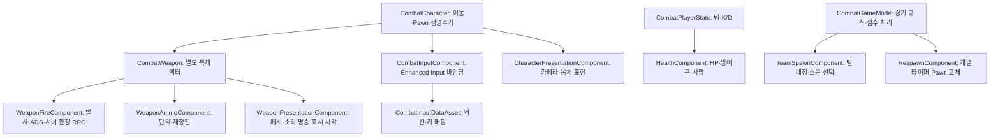

# 전투 구조와 상태 소유권

프로젝트 접두어를 C++ 클래스·파일명에서 제거한다. Unreal 모듈명 `Latency_MultiCombat`, API export 매크로와 빌드 타깃은 엔진 식별자로 유지한다. 기존 여섯 native 클래스의 이름은 `Config/DefaultEngine.ini`의 CoreRedirects로 새 이름에 연결한다.

## 객체 구조

Character가 무기 액터를 서버에서 생성하고 Owner와 Instigator를 자신으로 지정한다. 무기 액터의 Owner → Pawn → PlayerController 연결로 컴포넌트의 Server/Client RPC를 라우팅한다. 무기는 카메라에 부착하며 Pawn 종료 시 함께 제거한다. 리스폰은 새 Pawn과 새 무기 액터를 만든다. 현재 범위에는 드롭·인벤토리·무기 교체를 포함하지 않는다.

## SSOT

| 정보 | 설정 출처 / 런타임 소유자 |
|---|---|
| 캐릭터 설정 | `UCharacterDataAsset::Stats`, 미지정 시 `FCharacterStats` 기본값 |
| 무기 설정 | WeaponClass의 `CombatWeapon::WeaponData` → CharacterData의 DefaultWeapon → `FWeaponStats` 기본값 |
| 입력 설정 | `CombatInputDataAsset`; 미지정 시 동일 타입의 런타임 기본 매핑 |
| 검증된 무기 스탯 | `CombatWeapon::Stats`; 모든 무기 컴포넌트가 동일한 스냅샷 조회 |
| 설정 조회·보정, 거리 감쇠, 단위 변환 | `Data/CombatRules` |
| 실제 탄약·재장전 예약 | 무기의 `WeaponAmmoComponent` |
| 발사 간격·발사 번호·ADS·전투 상태 | 무기의 `WeaponFireComponent` |
| HP·방어구·사망, 스폰 HP/방어구 용량 | PlayerState의 `HealthComponent` |
| 팀·킬·사망 횟수 | `CombatPlayerState` |
| 팀 점수·경기 종료·승리 팀 | `CombatGameState` |
| 리스폰 타이머 | GameMode의 `RespawnComponent` |
| 스폰 충돌 크기 | 선택된 DefaultPawnClass의 실제 캡슐; 스폰 검사에 별도 크기 상수 없음 |

`CharacterData`는 캐릭터 설정이다. 무기 스폰 에셋 override는 별도 무기 클래스의 `WeaponData`에서 지정한다. Character의 `CurrentWeapon`, 탄약/발사/재장전 중계 API와 PlayerState의 HP 중계 API를 제거했다. 소비자는 무기·Health 컴포넌트를 직접 조회한다. `DefaultCharacterClass`는 제거하고 엔진의 `DefaultPawnClass`를 사용한다.

입력은 Enhanced Input 한 경로를 사용한다. 이전 `Legacy*`, BindAxis/BindKey, DefaultInput.ini의 AxisMappings, PlayerController의 매핑 설정과 Character의 개별 IA 필드를 제거했다. `CombatInputComponent::InputData`에 액션과 매핑을 함께 지정한다. 미지정 시 WASD/Mouse/Space/LMB/RMB/R의 기본 액션·매핑을 생성한다. 기존 마우스 축의 0.07 감도와 MouseY 반전을 modifier로 유지한다. Pawn 종료 시 해당 입력 바인딩과 매핑 컨텍스트를 해제한다.

방어구 흡수 비율은 캐릭터 Stats의 `ArmorAbsorptionRatio`로 설정한다(기본 0.5). `ResetForRespawn`도 마지막 스폰의 에셋 설정에 따른 HP·방어구를 복원한다. 원래 게임의 Pawn 재생성 경로는 동일하게 스폰 에셋으로 초기화한다.

## 복제와 경계

- 무기 액터, Fire의 CombatState/ADS는 소유 Pawn의 relevancy를 따른다.
- 탄약은 Ammo 컴포넌트에서 `COND_OwnerOnly`로 복제한다.
- Health 컴포넌트는 PlayerState에 부착하므로 Pawn 교체와 무관하게 유지되며 모든 클라이언트에 복제한다.
- HP·탄약 쓰기는 소유 액터의 서버 권한을 확인한다. 클라이언트는 조준 방향과 발사 ID만 전달한다.
- 서버 승인 이후 effects/hit 응답을 보내는 기존 Baseline 동작을 유지한다. Prediction/Reconciliation과 Lag Compensation은 후속 작업이다.
- 계측은 Pawn과 무기가 각각 도착하는 순서를 가정하지 않고, 실제 Fire 컴포넌트가 바뀌면 delegate를 재연결한다.
- PlayerController에는 입력 모드와 테스트 컴포넌트 구성만 남긴다. smoke 자동 조작은 `CombatSmokeComponent`, 정량 계측은 `CombatBenchmarkComponent`가 담당한다.
- 타이머·스폰 관찰 콜백은 이름 있는 함수와 UObject/raw delegate 바인딩을 사용한다. C++ 소스에 람다를 사용하지 않는다.
- 객체 포인터와 컨테이너 순회 변수는 명시 타입을 사용한다. `const`와 참조 여부를 유지하고 `auto`로 변수 타입을 숨기지 않는다.
- `.clang-format`을 기준으로 C++ 줄 배치와 들여쓰기를 통일한다. Unreal generated 헤더 순서를 유지하기 위해 include 정렬은 비활성화한다.

## API 이전

| 기존 접근 | 새 접근 |
|---|---|
| Character.CombatState | Character.GetCombatState() 또는 Weapon.Fire.GetCombatState() |
| Character.MagazineAmmo / ReserveAmmo | Weapon.Ammo.GetMagazineAmmo() / GetReserveAmmo() |
| Character.FireWeapon / StartReload / StopReload | Weapon.Fire.FireWeapon / Weapon.Ammo.StartReload / FinishReload |
| Character.CurrentWeapon | WeaponClass의 WeaponData 또는 CharacterData.DefaultWeapon |
| Character.IA_* / PlayerController.CombatMappingContext | Character.CombatInput.InputData의 액션과 MappingContext |
| Character.OnShotSubmitted / OnShotFeedback / OnHitConfirmed | Weapon.Fire의 동일 delegate |
| Character.ServerFire / ServerStartReload | Weapon.Fire.ServerFire / Weapon.Ammo.ServerStartReload |
| PlayerState.CurrentHealth / CurrentArmor / MaxHealth / bIsDead | PlayerState.Health.GetHealth() / GetArmor() / GetMaxHealth() / IsDead() |
| Character.FirstPersonWeapon | Character.GetWeapon().WeaponMesh |
| GameMode.DefaultCharacterClass | GameMode.DefaultPawnClass |

CoreRedirects는 native 부모 클래스의 이름 변경을 처리한다. 제거된 필드를 직접 참조하는 사용자 Blueprint 노드는 위 getter나 컴포넌트 접근으로 이전해야 한다. 저장소의 기존 BP_Default는 Engine.Pawn 기반이며 그대로 로딩 가능한지 확인한다. 기존 native Character 경로가 새 클래스로 리다이렉트되는지도 별도 검사한다.

스폰 지점이 모두 점유되었을 때의 엔진 fallback, TeamSize의 인원 제한 미적용, 도착 시각 기준 연사 제한은 이번 구조 변경에서 정책을 바꾸지 않는다.

## 검증

기존 `LatencyCombat` 테스트는 컴포넌트 getter를 통해 동일 게임 동작을 검사한다. 구조 테스트는 별도 무기 액터의 소유권·부착·복제·수명, 클라이언트 탄약 변경 차단, 기존 Blueprint 로딩과 native 클래스 경로 리다이렉트, 기본 입력 방향·감도와 비기본 에셋의 HP/방어구/탄약/재장전 설정을 확인한다. 테스트는 런타임 탄약을 직접 덮어쓰지 않고 에셋 입력으로 조건을 구성한다.

2026-10-11 macOS / UE 5.7.4 검증:

- `Latency_MultiCombatEditor Mac Development` 빌드 성공.
- `LatencyCombat` 자동화 테스트 9/9 통과.
- 별도 서버와 클라이언트 2개: PktLag=0 smoke 양쪽 PASS.
- PktLag=50ms(왕복에 약 100ms 추가) benchmark: 24발, 양쪽 PASS. 이동·점프·HP/점수 복제·재장전·리스폰 및 관찰 클라이언트의 사망 후 발사 차단 확인.
- clang-format dry-run과 git diff --check 통과.

네트워크 로그는 `Saved/FPSBaseline/RefactorVerification/`에 저장한다. 위 검증은 구조 변경의 회귀 검사다. 기존 360표본 결과를 다시 실행하거나 이동 표적의 Lag Compensation 성능을 검증한 결과는 아니다. 입력 테스트는 액션 매핑과 modifier의 방향·감도를 검사하며 실제 화면 렌더링과 물리 입력 지연은 측정하지 않는다.
